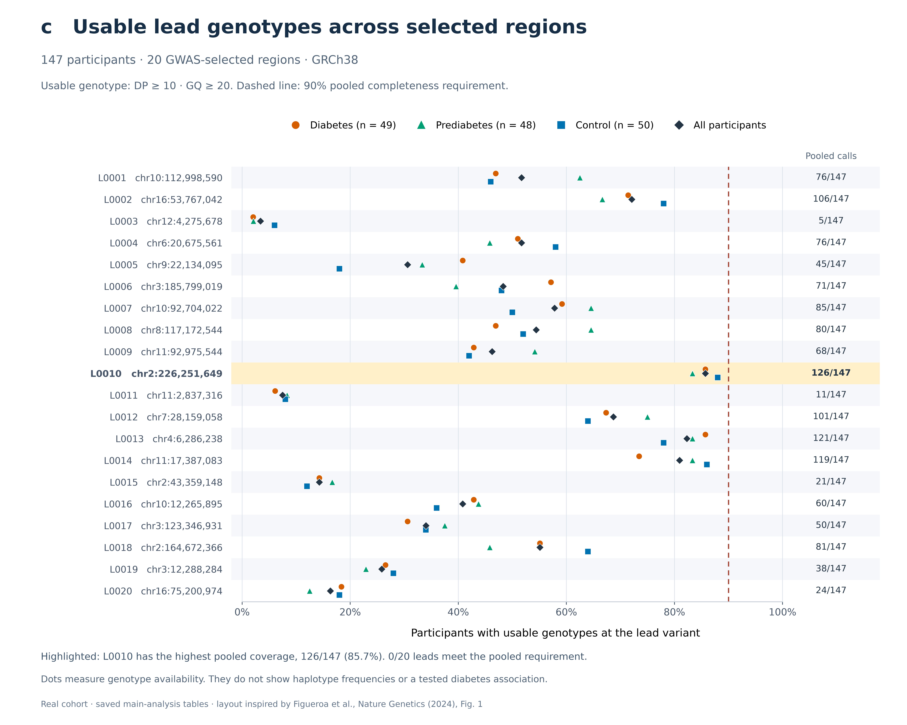

# Panel C and three-group haplotype results

[PNG, 600 dpi](panel_c.png) · [Vector PDF](panel_c.pdf) · [Editable SVG](panel_c.svg)

[Full one-figure report](report.html) · [Plain-text results](REPORT.txt) · [Reproduction instructions](../haplotype_comparison.md)

## Result — 13 October 2026

The real cohort contains **49 Diabetes, 48 Prediabetes and 50 Control**
participants. **No haplotype can currently be identified as differing between
these groups.** None of the 20 selected regions produced a usable haplotype
panel, so frequencies, overall/pairwise effects, confidence intervals and
adjusted p-values are unavailable. No comparisons were performed; this does
not establish equality or absence of association.

Panel C retains the existing paper-inspired layout and shows **genotype
completeness**, not haplotype frequencies. Each row is a GWAS lead variant.
Colored symbols show usable calls within each group; black diamonds combine
all participants. The dashed line marks the 90% pooled requirement. The best
lead has **126/147 usable calls (85.7%)**; all 20 fall below 90%. The main run
records 19 exclusions for completeness and one for unconfirmed palindromic
allele orientation. Missing genotypes remain missing.

No high-quality reference-homozygous calls were observed in the selected
windows. Reliable joint genotypes including reference calls and phase are
needed before the intended haplotype comparison can be resolved.

## Tables and causal-evidence audit

- [Overall comparisons](haplotype_overall_comparisons.tsv) and [pairwise effects, intervals and adjusted p-values](haplotype_comparisons.tsv).
- [Haplotype frequencies](haplotype_group_frequencies.tsv), [per-region status](comparison_status.tsv), and [machine-readable result counts](comparison_results.json).
- [20 supplied external GWAS leads](external_gwas_leads.tsv), [legacy fine-mapping audit](legacy_locus_audit.tsv), and [candidate variants](candidate_variants.tsv).
- [Causal-evidence explanation](VARIANT_EVIDENCE.txt) and [audit provenance and limitations](variant_evidence_audit.json).
- [Plotted aggregate counts](panel_c_data.tsv) and [figure provenance](panel_c_manifest.json).
- [Independent R/Python table parity](R_python_parity.json) and [validation and package versions](validation.json).

Header-only frequency, comparison and candidate tables mean **not estimable or
not tested**, rather than negative findings. No associated cohort haplotype is
available for candidate-variant localization. The legacy audit examined 614
loci: 607 successful fits all lacked reference-homozygous calls in their retained
LD inputs; 594 contained palindromic variants without recorded orientation
validation. Legacy PIPs are therefore not presented as validated causal rankings.
External GWAS signals alone cannot establish group differences in this cohort.

## Reproduction and source figure

Use the [Python workflow](../haplotype_comparison.md) or the independent
[R implementation](../../code/R/README.md). The completed local publication
comes from `results/haplotype_comparison_20261013/publication_verified/`.
The repository contains only aggregate exports; detailed participant files
remain local or in the separate private data repository.

Only panel C appears in this report. The PNG is 7,800 × 6,240 pixels; PDF and
SVG contain the same figure. Layout inspiration:
[Figueroa et al. (2024), Figure 1](https://www.nature.com/articles/s41588-024-01719-5/figures/1).
This cohort figure is not a replication of the paper's founder-haplotype study.
